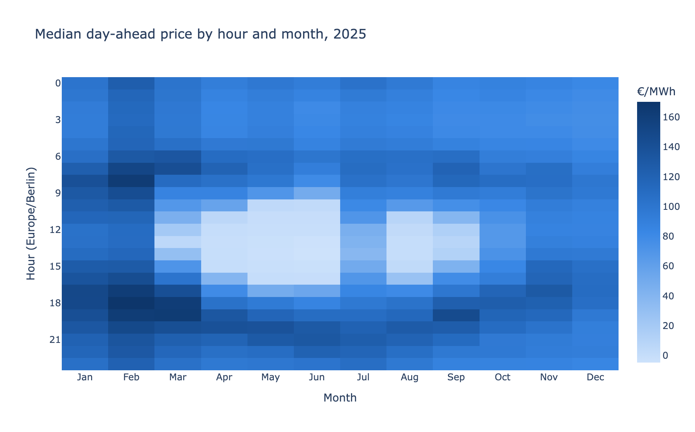
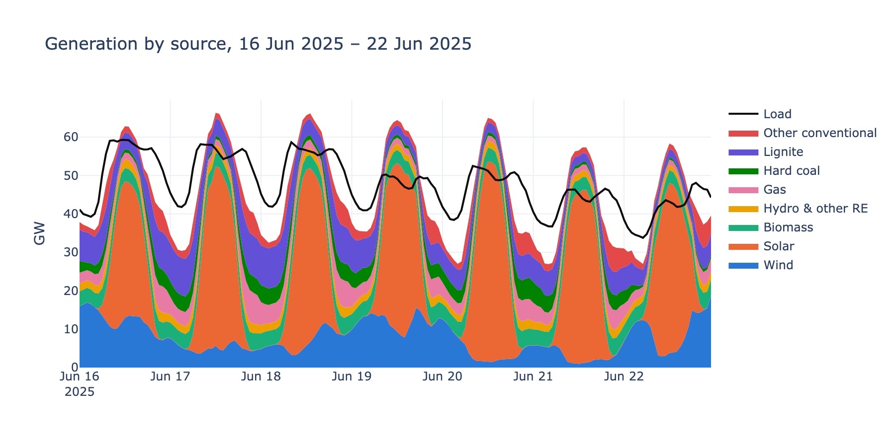
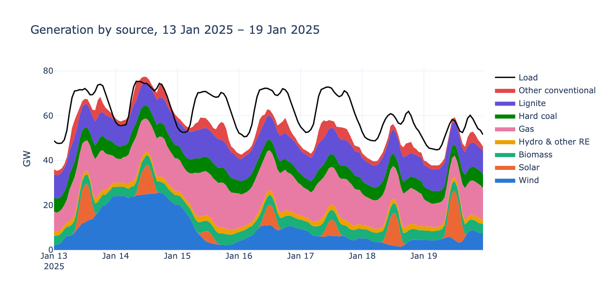
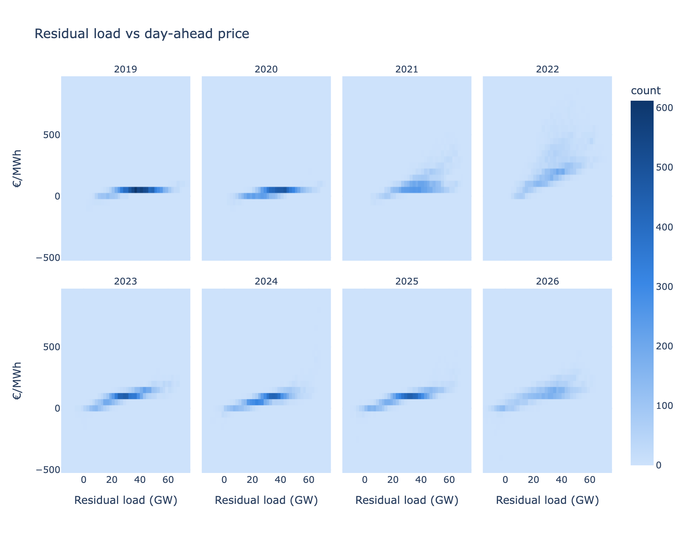

# German day-ahead power prices: forecast and explain

Forecasting hourly day-ahead electricity prices for the German-Luxembourg bidding zone and explaining how wind, solar and load drive them. A Streamlit dashboard shows the energy mix across hours, days and years.

**Live app:** [energyday-aheadforecast.streamlit.app](https://energyday-aheadforecast-243klyvi9tmndknagytd8m.streamlit.app/)



The heatmap shows the patterns that make this market interesting: the solar trough around midday in summer, evening peaks in winter, and a growing number of hours with negative prices.

| Year | Mean price (€/MWh) | Hours with negative price |
|---|---|---|
| 2019 | 37.7 | 211 |
| 2020 | 30.5 | 298 |
| 2021 | 96.8 | 139 |
| 2022 | 235.4 | 69 |
| 2023 | 95.2 | 301 |
| 2024 | 78.5 | 457 |
| 2025 | 89.3 | 573 |
| 2026 (to 8 Nov) | 117.7 | 462 |

### Generation mix: summer vs. winter week

In summer, solar pushes the price to zero or below around midday and the price recovers in the evening. In winter, wind and fossil plants cover the load and prices peak in the morning and evening.




### Merit order

Residual load is the load that wind and solar do not cover. Each year it traces the supply curve: low residual load meets cheap or negative prices, and high residual load requires gas plants that set the price. The 2022 panel shows the gas crisis.



## Setup

- **Data:** [SMARD](https://www.smard.de) (Bundesnetzagentur), hourly from 2019. Includes price, generation by source, load, and TSO forecasts for load, wind and solar. Weather forecasts come from Open-Meteo (previous model runs), and EUA and coal prices from Yahoo Finance.
- **Forecast task:** Delivery day D is forecast at 12:00 on D-1, which is gate closure of the day-ahead auction. Inputs are limited to what is known at that point: price lags of at least 24 h, statistics of the previous day, and the TSO forecasts for D. Actual generation is never used.
- **Evaluation:** Walk-forward backtest with a monthly refit.
  - Features and hyperparameters were chosen on a validation year (Nov 2024 – Oct 2025) and a feature-selection window (Mar – Oct 2025).
  - The test year (Nov 2025 – Oct 2026) starts after the release of Chronos-2, so the foundation model has not seen it.

## Models

| Model | Description |
|---|---|
| `naive_24h` | Price of the same hour on the previous day |
| `lightgbm` | Gradient boosting on 20 SHAP-pruned features, 2-year rolling window, L1 loss. It predicts the deviation from the previous day's mean price. |
| `chronos2_cov` | [Chronos-2](https://huggingface.co/amazon/chronos-2), zero-shot, 2048 h context, TSO forecasts as covariates |
| `ensemble` | Mean of `lightgbm` and `chronos2_cov`, fixed before the test year |

## Results (test year Nov 2025 – Oct 2026, 8760 hours)

| Model | MAE (€/MWh) | RMSE (€/MWh) | Bias (€/MWh) |
|---|---|---|---|
| ensemble | 12.59 | 23.08 | −1.85 |
| chronos2_cov | 12.59 | 23.93 | −0.62 |
| lightgbm | 14.65 | 24.93 | −3.09 |
| naive_24h | 31.26 | 48.84 | −0.43 |

- **Chronos-2 vs. LightGBM:** Chronos-2 with covariates beats the tuned LightGBM without any training. Without covariates it reaches an MAE of 21.7, so most of its skill comes from the TSO forecasts.
- **Ensemble:** It matches Chronos-2 on MAE and has the lowest RMSE, so it makes fewer large errors.
- **Choice of feature set:** The pruned LightGBM set was adopted after the test year had been evaluated. The set selected before pruning scores 15.11. Forecasts from November 2026 onward are the clean holdout for this choice.

## Explanation

- **Feature level:** TreeSHAP from LightGBM. Almost all of the signal flows through residual load (load − wind − solar): its intraday shape, its change from the previous day, and its level.
- **Driver level:** Wind, solar and load are treated as players in an exact Shapley decomposition. Each TSO forecast is either kept or set to its mean over the test year. All derived features are rebuilt and the model is evaluated on all 2³ combinations. The three effects add up exactly to the forecast, relative to an average hour.

## Reproduce

```bash
uv sync
uv run python scripts/download_smard.py
uv run python scripts/download_extra.py
uv run python scripts/benchmark.py
uv run python scripts/build_app_data.py
uv run streamlit run app/streamlit_app.py
```

- `benchmark.py` runs the walk-forward backtest for the selected models from any start date (`--start`, `--end`, `--models`) and logs to Weights & Biases (`--no-wandb` to disable).
- `build_app_data.py` precomputes everything the app shows. It also issues a forecast for the latest day with complete TSO forecasts and appends it to `data/app/forecasts.parquet`, which builds a live track record.
- Chronos-2 runs in a separate process because torch and LightGBM ship conflicting OpenMP runtimes.

## Structure

```
src/energy_forecast/   data loading, features, models, explanation, plots
scripts/               downloads, benchmark, feature pruning, app data
notebooks/             01 EDA, 02 forecast backtest, 03 SHAP explanation
app/                   Streamlit dashboard (reads precomputed data/app/*.parquet)
```
